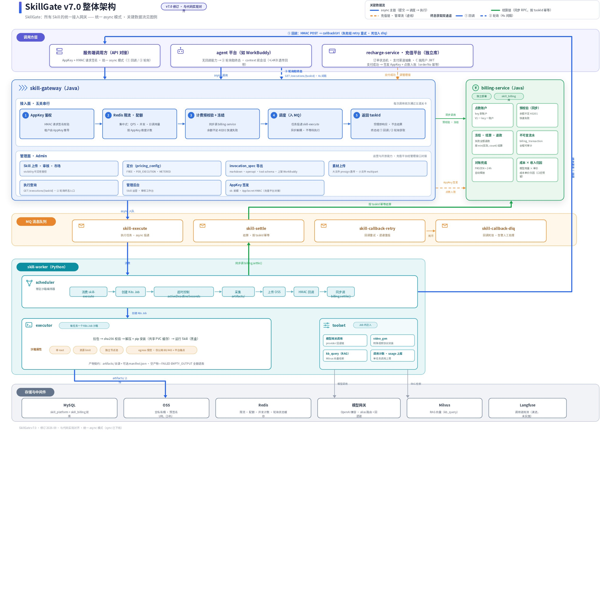
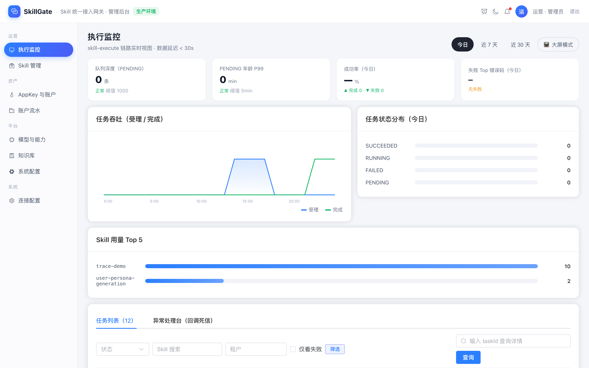
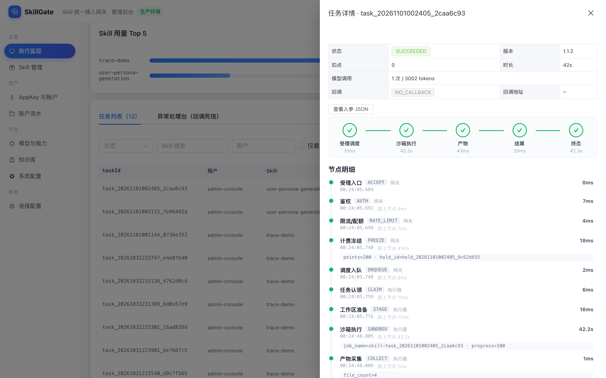
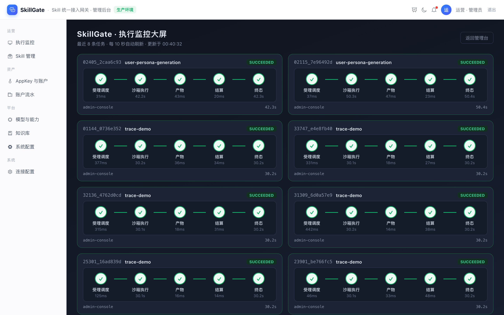
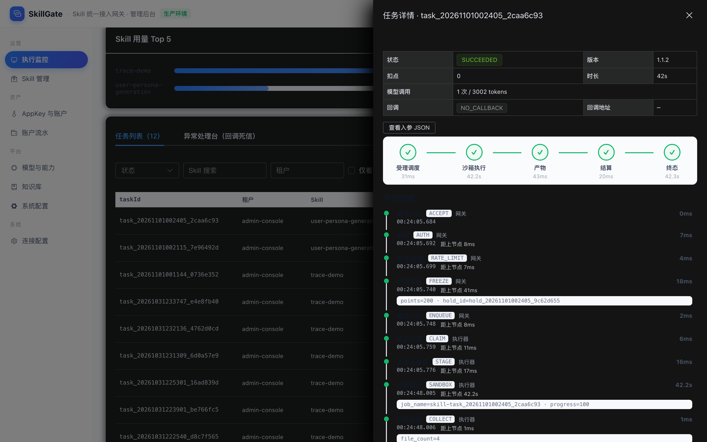
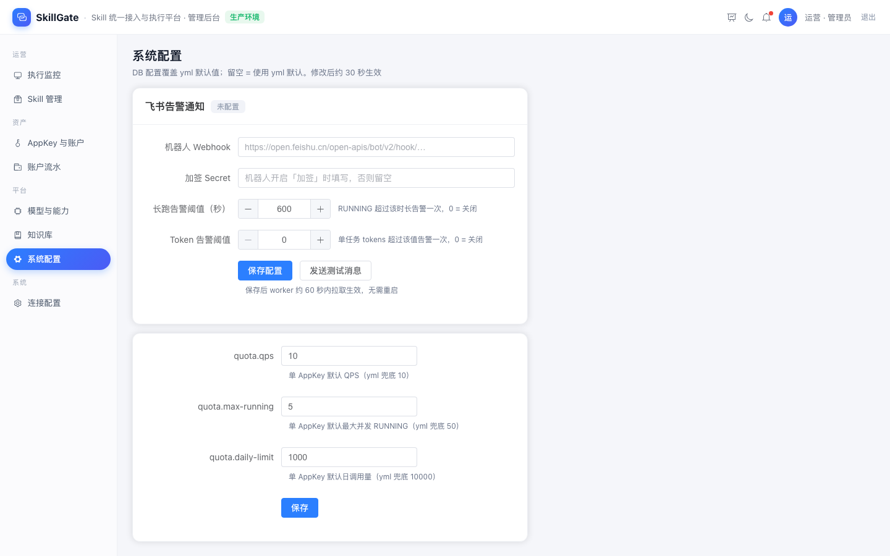
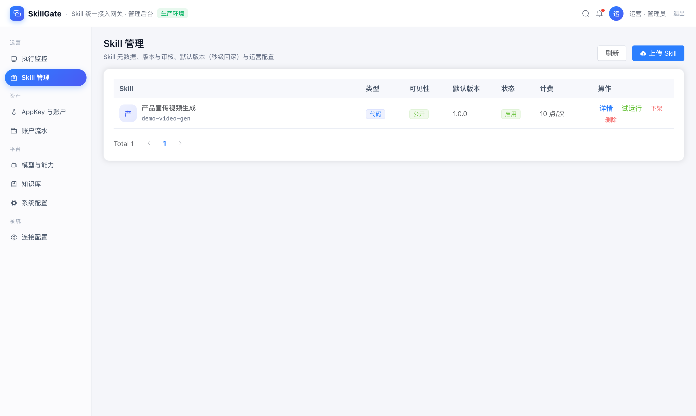
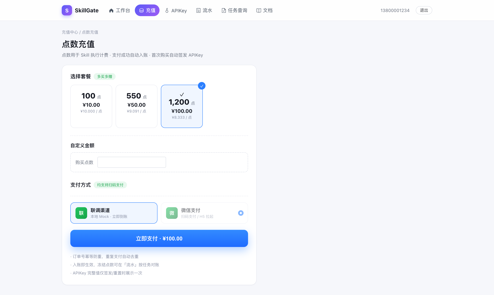
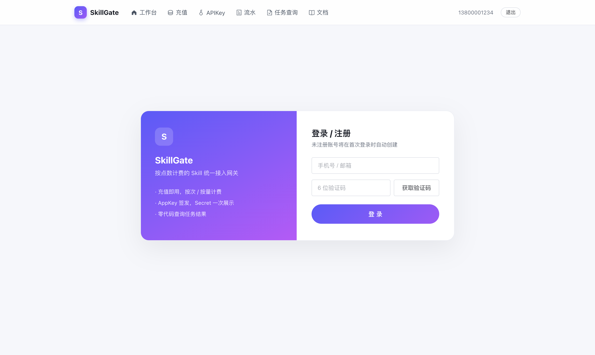

# SkillGate — Skill 统一接入与执行平台

用户将技能（Skill）上传到平台，外部调用方（服务端 / agent 平台）经统一网关发起调用，平台负责沙箱执行编排。**平台统一承担：鉴权限流 · 执行调度 · 沙箱隔离 · 计费结算 · 用量统计 · 可观测**。



- **一次请求 = 一个 Skill = 一个 taskId**：统一异步，结果回调（HMAC 签名）/ 主动轮询双通道
- **Skill 纯黑盒 + 沙箱隔离**：每任务独立 K8s Job（非 root / 只读根文件系统 / 出口受控），支持 CODE（`main.py`）与 AGENT（`SKILL.md`）两种包类型
- **计费前置**：预校验 → 冻结 → 按实际结算 → 失败即退，点数账户对账兜底闭环
- **全链路可观测**：任务节点事件 100% 落库，时间线 / CI-CD 式流程图 / 监控大屏纯 MySQL 渲染，零部署组件（OTel 内置默认关）
- **运行中治理**：卡住任务一键强制终止（按已发生用量结算 / 余款退还）；飞书群告警（长跑 / 失败 / token 超限），配置在后管热生效
- **模型能力平台管**：内置 OpenAI 兼容模型网关（alias 路由 + 回退链），密钥永不下发到 Skill 包
- **两层输入**：materials（素材）+ instructions（自然语言指令），无 Schema 校验

## 页面预览

| **执行监控 · 看板与列表** | **任务详情 · 执行链路流水线** |
|---|---|
|  |  |
| **监控大屏（/wall 轮播流水线墙）** | **暗色模式** |
|  |  |
| **告警配置（系统配置页）** | Skill 管理（管理后台） |
|  |  |
| 点数充值（用户端） | 登录 / 注册（用户端） |
|  |  |

> 更多时序图（上传审核 / 执行 / 计费 / 支付）见 [`docs/images/`](docs/images/)，完整技术方案见 [`docs/ARCHITECTURE.md`](docs/ARCHITECTURE.md)。

- **一次请求 = 一个 Skill = 一个 taskId**：统一异步，结果回调（HMAC 签名）/ 主动轮询双通道
- **Skill 纯黑盒 + 沙箱隔离**：每任务独立 K8s Job（非 root / 只读根文件系统 / 出口受控），支持 CODE（`main.py`）与 AGENT（`SKILL.md`）两种包类型
- **计费前置**：预校验 → 冻结 → 按实际结算 → 失败即退，点数账户对账兜底闭环
- **全链路可观测**：任务节点事件 100% 落库，时间线 / CI-CD 式流程图 / 监控大屏纯 MySQL 渲染，零部署组件（OTel 内置默认关）
- **运行中治理**：卡住任务一键强制终止（按已发生用量结算 / 余款退还）；飞书群告警（长跑 / 失败 / token 超限），配置在后管热生效
- **模型能力平台管**：内置 OpenAI 兼容模型网关（alias 路由 + 回退链），密钥永不下发到 Skill 包
- **两层输入**：materials（素材）+ instructions（自然语言指令），无 Schema 校验

## 架构总览

```
调用方 ──POST /execute──→ skill-gateway（鉴权→限流→计费冻结→入 MQ）
                              └→ skill-worker（K8s Job 沙箱执行 → 产物落 OSS → 结算 → 回调/轮询）
recharge-service（充值平台：订单 / 支付渠道 / C 端用户）──orderNo 幂等入账──→ billing-service（账户 / 冻结 / 结算 / 流水 / 对账）
```

| 模块 | 技术栈 | 职责 |
|---|---|---|
| [skill-gateway](skill-gateway/) | Java / Spring Boot | 统一接入网关：HMAC 鉴权、三级限流（QPS / 租户并发 / 日调用量）、计费预校验与冻结、调度入 MQ、执行查询/取消/重试、Skill 生命周期与市场、素材双通道、模型网关、FREE 埋点 |
| [billing-service](billing-service/) | Java / Spring Boot | 点数账户（key 即账户）、冻结 / 结算 / 退款、不可变流水、FROZEN 超 24h 对账兜底；独立部署独立库 |
| [skill-worker](skill-worker/) | Python | 消费 `skill-execute`，每任务编排为一个加固 K8s Job 沙箱；先落产物 → 再结算 → 最后置终态；看门狗故障自愈；回调 HMAC 签名 + 1/5/15min 退避重试；飞书群告警（长跑 / 失败 / token 超限） |
| [recharge-service](recharge-service/) | Java / Spring Boot | 充值平台：订单状态机、支付渠道抽象（微信 Native / 支付宝骨架 / Mock）、C 端用户体系；独立部署独立库 |
| [frontend/admin-console](frontend/admin-console/) | Vue 3 + Element Plus | 管理后台：执行监控（时间线 / CI-CD 流程图 / 大屏 / 暗色 / 强制终止）、Skill 管理、AppKey 与账户、模型路由、KB、系统配置（含飞书告警） |
| [frontend/user-portal](frontend/user-portal/) | Vue 3 | 用户中心：充值、APIKey 管理、流水、任务查询 |

## 核心机制速览

| 机制 | 说明 |
|---|---|
| 受理五关 | ① AppKey HMAC 鉴权 → ② Redis 限流/配额 → ③ 计费预校验+冻结 → ④ 调度入 MQ → ⑤ 返回 taskId |
| 幂等 | `clientRequestId` 幂等命中先于冻结；并发同键败者立即释放 hold；MQ 发送失败当场回滚 |
| 顺序不变量 | 先落产物 → 再结算（同步 RPC，失败 MQ 兜底）→ 最后置终态——无「完成但无结果」竞态 |
| 看门狗 | PENDING 超 5min 重投 / 超 30min 置失败退款；RUNNING 超时收殓；Job missing 连续 2 周期防抖后条件回滚重投 |
| 取消 | PENDING 直接 CANCELLED + 退款；RUNNING 置 CANCELLING 由 worker 杀 Job 收殓 |
| 多租户 | OSS 前缀逻辑隔离 + 预签名（凭据不出平台）；MySQL 行级 tenant_id；Milvus collection 物理隔离 |
| 执行链路观测 | 全任务节点事件落库 `execution_event`（受理五关→沙箱→结算→回调），后管时间线 / CI-CD 式流程图 / 监控大屏纯 MySQL 渲染；OTel 内置默认关，零部署组件 |
| 运行中治理 | 管理台强制终止（Redis 加速标志立即杀沙箱，按已发生用量结算 / 余款退还）；飞书群告警（长跑 / 失败 / 看门狗干预 / token 超限，可选加签，未配置 no-op）；列表按时长 / tokens 排序。告警配置统一维护于系统配置页（sys_config），保存热生效无需重启 |

## 快速开始

```bash
# 0) 准备基础设施（MySQL 8 / Redis / RocketMQ，或用 docker-compose 自建）
# 1) 配置环境变量：复制 skill-worker/.env.example 为 .env 并填写；
#    各服务的密钥（OSS/COS、CRYPTO_KEY、ADMIN_TOKEN、JWT_SECRET 等）一律经环境变量注入，仓库不保留真实凭证
# 2) 初始化数据库：各服务 src/main/resources/db/ 下schema-*.sql（或直接用 docker-compose 的 MySQL 自动建库）
# 3) 启动四个后端（dev profile，默认端口 gateway 8888 / billing 8081）
cd skill-gateway   && mvn spring-boot:run -Dspring-boot.run.profiles=dev
cd billing-service && mvn spring-boot:run -Dspring-boot.run.profiles=dev
cd recharge-service && mvn spring-boot:run -Dspring-boot.run.profiles=dev
cd skill-worker    && python -m skill_worker.scheduler.main   # SANDBOX_MODE=local 本地直跑
# 4) 前端
cd frontend/admin-console && npm i && npm run dev
cd frontend/user-portal   && npm i && npm run dev
```

> **可观测性（默认零额外组件）**：管理后台的执行链路时间线与任务流程图数据落 MySQL（`execution_event`），开箱即用。OpenTelemetry 埋点内置但默认关闭（traces/logs/metrics 三通道 `none`），需要 span 级追踪时接任意 OTLP 后端：`OTEL_TRACES_EXPORTER=otlp` + `OTEL_EXPORTER_OTLP_ENDPOINT=…`（gateway/billing；worker 用 `OTEL_EXPORTER_OTLP_ENDPOINT`，见 `otel.*` 配置）。KB 向量检索同理：`--profile kb` 启动 Milvus。

## 目录结构

```
skill-platform/
├── skill-gateway/        # 统一接入网关（Java）
├── billing-service/      # 计费服务（Java，独立库）
├── skill-worker/         # 沙箱执行编排（Python）
├── recharge-service/     # 充值平台（Java，独立库）
├── frontend/
│   ├── admin-console/    # 管理后台（Vue 3）
│   └── user-portal/      # 用户中心（Vue 3）
└── templates/
    └── agent-skill-bridge/   # SKILL.md 型技能零改造接入的标准桥
```

## 安全说明

- 所有密钥（对象存储、数据库、支付渠道、签名密钥）一律经环境变量注入，仓库仅保留 `change-me` 占位符与 `.env.example` 模板
- 请勿将真实凭证提交进仓库；建议启用 secret scanning（GitHub 自带 push protection / gitleaks）
- 如果历史版本曾泄露过密钥，请**立即在云厂商控制台轮换**，仅从代码中删除是不够的
- **本地 pre-commit 安全网**（推荐开启）：拦截疑似云凭证明文（腾讯云 SecretId / 内部桶名）入库

  ```bash
  git config core.hooksPath .githooks   # 激活仓库钩子（已知泄露密钥黑名单 .githooks/deny-local.txt 本地维护，不入库）
  ```

## License

本项目基于 [Apache License 2.0](LICENSE) 开源。
